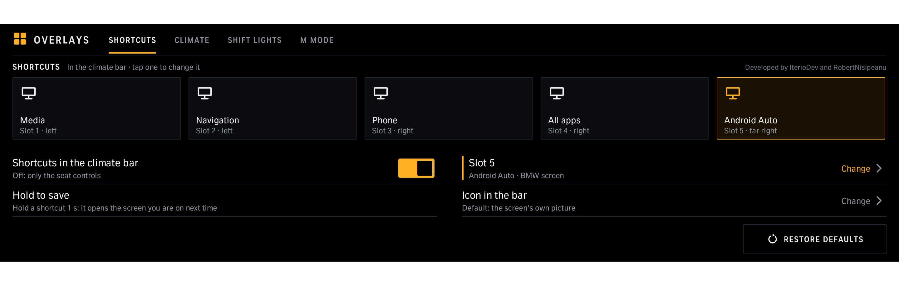
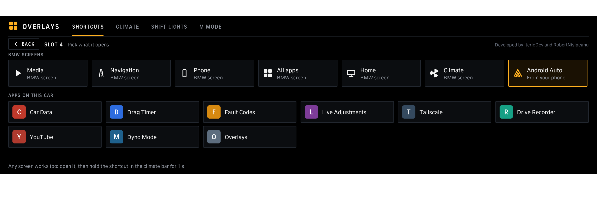
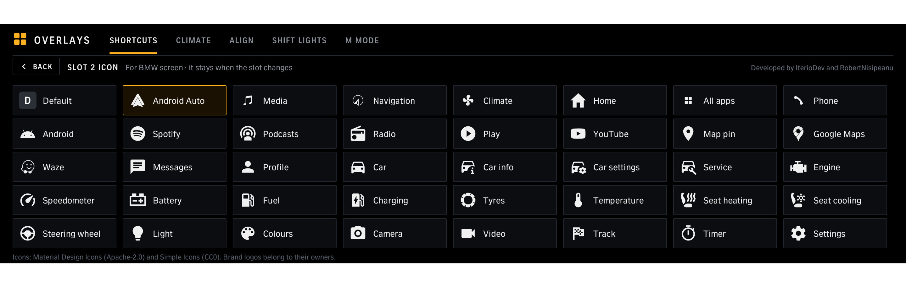
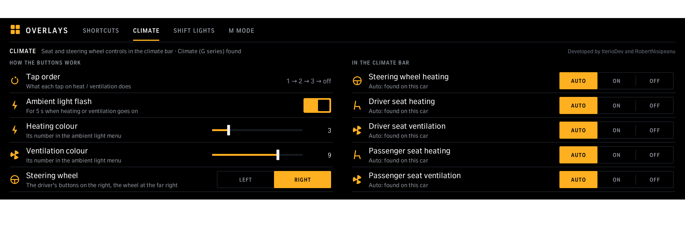
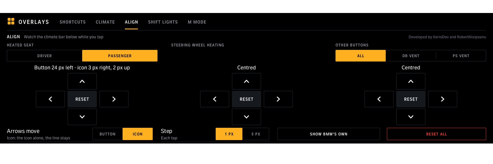
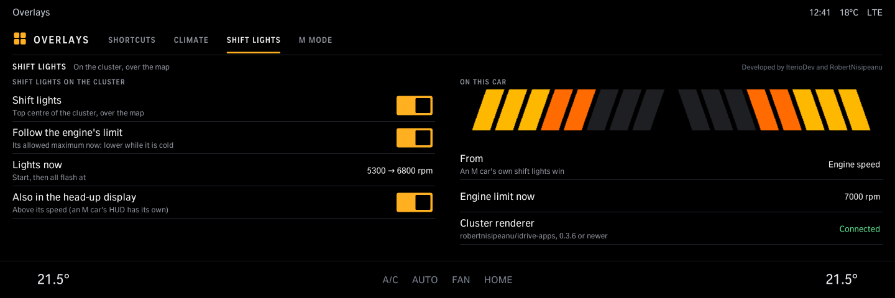
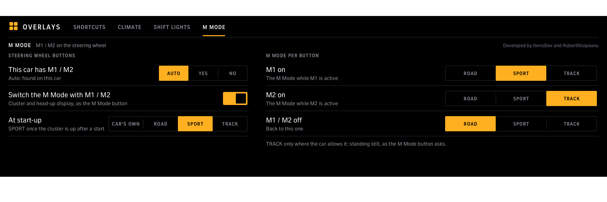

# eOverlays

Set up the Overlays strip in the climate bar: what each of the four shortcuts opens (BMW screens or apps) and its icon in the bar (Android Auto, Spotify, Waze and 36 more), the seat heating / ventilation and steering wheel buttons, nudging each of them into place (Align), the tap order, shift lights on the instrument cluster for cars without their own, not M cars (needs Cluster renderer from robertnisipeanu/idrive-apps), and on M cars which M Mode M1 / M2 switch to. Needs the Overlays tool from the same source.

Version 1.31.0 · iDrive 8 only · package `carlm_overlays` · [all apps and how to install](../../README.md)

> [!NOTE]
> The strip in the climate bar is car-tested (G82); the app's pages are not yet. Needs the Overlays tool (the Store installs it with the app).

## Screens

Screens from the app's offline test against a simulated car, so the values are made up. The climate bar along the bottom is the test's stand-in for the car's own.

### Shortcuts

The five slots (a fifth at the free cooled-seat spot on the right); tap one to change it.

### Picking a slot

BMW screens or the apps on this car.

### Shortcut icons

*Icon in the bar* on the Shortcuts page: the picture a shortcut shows in the climate bar, instead of the screen's own (39 icons: the car's own quick-select set - Media, Navigation, Climate, Home, All apps, Phone - plus Android Auto (white, or *Android Auto live*: in its colours while a phone's Android Auto is connected, white while not; the Shortcuts page shows what the car reads), Spotify, Waze, Google Maps, YouTube, car and comfort icons). It stays with the shortcut when you change what it opens; *Default* goes back to the screen's own picture. For an Android Auto shortcut: pick *Android Auto* in the slot's picker (it takes the Android Auto live icon), then once open Android Auto and hold that shortcut 1 s, as the page asks: that teaches the car's screen, and taps open it after that. Icons: Material Design Icons (Apache-2.0) and Simple Icons (CC0). Needs the Overlays tool 0.6.0.

### Climate

Tap order, the ambient light flash and its colours, the steering wheel's side (*Right* for a right-hand drive car: the driver's buttons on the right), and which seat and steering wheel buttons the strip shows.

### Align

Hidden until you tap *Developed by IterioDev and RobertNisipeanu* (top right of any page) 5 times; 5 more hide it again. When a seat or steering wheel icon in the bar is not quite over the car's own spot: an arrow pad each for the heated seat (driver or passenger), the steering wheel heating, and the other buttons (all of them at once, or a seat's ventilation). Tap the arrows while you watch the climate bar, 1 or 5 px at a time; the middle button resets that one. *Arrows move: Button* moves the whole button (icon, coloured line and touch area); *Icon* moves the icon alone; *Line* shapes the coloured line: up / down slides it onto the car's own accent line, left / right makes it longer (into the car's line to the left, or to the right) so it reads as one continuous line. A taller mask hides the car's line under ours. *Show BMW's own* hides the strip's seat and wheel buttons for 20 s so the car's own show: line the button up with them, then centre the icon. Kept over updates. Needs the eOverlays tool 0.7.0.

### Finder (hidden)

Shown with Align (the 5 taps). Finding the car's "track my car" setting. *Record*: 10 s of quiet (the files the unit writes by itself, left out), then switch Track my BMW off and on and tap *Stop*: the files that changed meanwhile (`finder-record.txt`). *Scan* searches the head unit's own configuration files, read-only, for privacy, location and tracking services; the most telling lines first, 16 a page, the full list saved on the unit (`/var/opt/carlm-overlays/finder.txt`). Read-only. Needs the eOverlays tool 0.12.0.

### Shift lights

On the instrument cluster for cars without their own (an M car shows its own, so these are hidden there): start and flash rpm (or the engine's own limit), also in the head-up display. Needs Cluster renderer 0.3.6 or newer.

### M Mode

M cars: the M Mode that M1, M2 and off switch to, and *At start-up*: the M Mode a start begins in once the cluster is up (*Car's own*, Road, Sport or Track).
