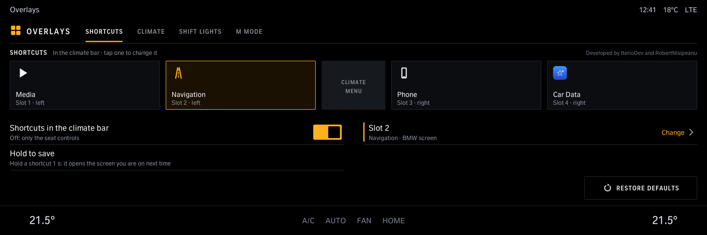
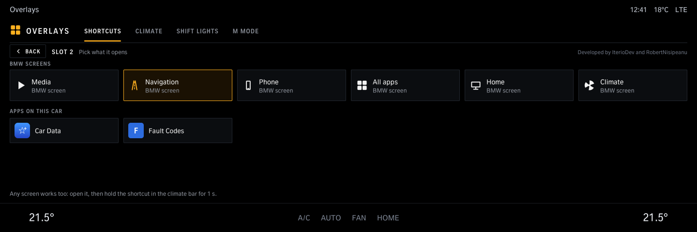
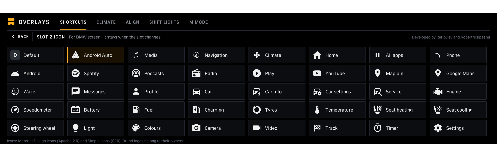
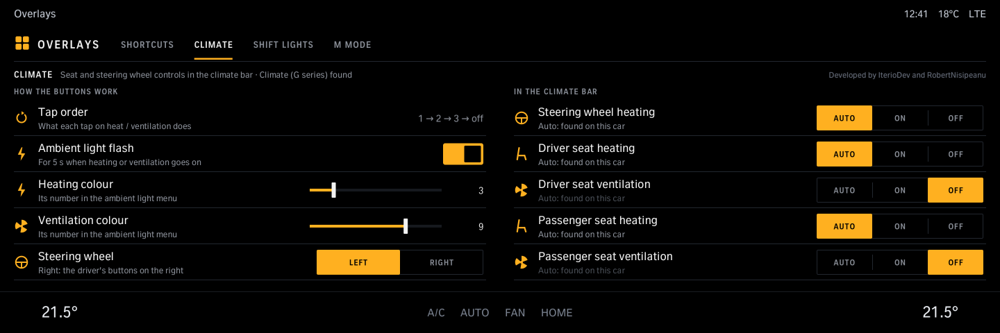
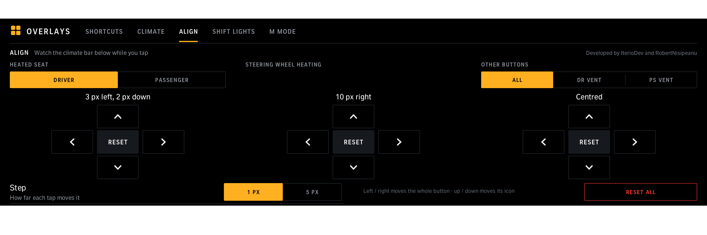
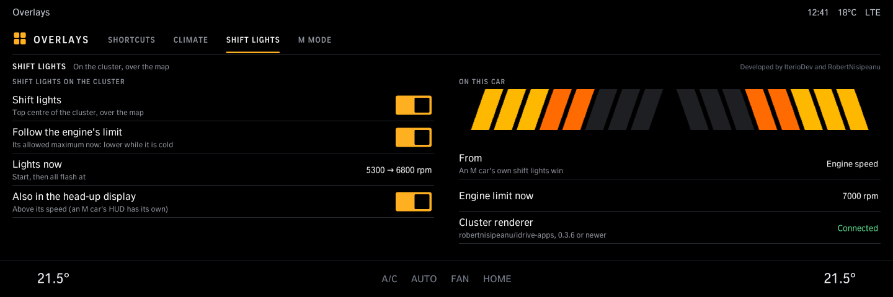
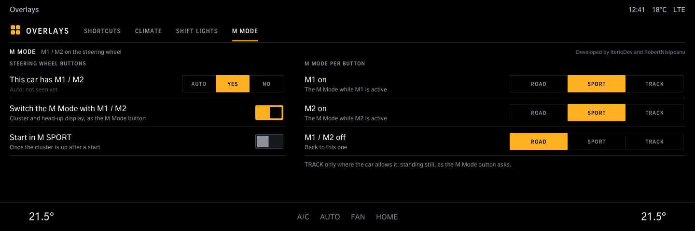

# eOverlays

Set up the Overlays strip in the climate bar: what each of the four shortcuts opens (BMW screens or apps) and its icon in the bar (Android Auto, Spotify, Waze and 36 more), the seat heating / ventilation and steering wheel buttons, nudging each of them into place (Align), the tap order, shift lights on the instrument cluster for cars without their own, not M cars (needs Cluster renderer from robertnisipeanu/idrive-apps), and on M cars which M Mode M1 / M2 switch to. Needs the Overlays tool from the same source.

Version 1.6.0 · iDrive 8 only · package `iteriodev_overlays` · [all apps and how to install](../../README.md)

> [!NOTE]
> The strip in the climate bar is car-tested (G82); the app's pages are not yet. Needs the Overlays tool (the Store installs it with the app).

## Screens

Screens from the app's offline test against a simulated car, so the values are made up. The climate bar along the bottom is the test's stand-in for the car's own.

### Shortcuts

The four slots next to *CLIMATE MENU*; tap one to change it.

### Picking a slot

BMW screens or the apps on this car.

### Shortcut icons

*Icon in the bar* on the Shortcuts page: the picture a shortcut shows in the climate bar, instead of the screen's own (39 icons: Android Auto, Spotify, Waze, Google Maps, YouTube, car and comfort icons). It stays with the shortcut when you change what it opens; *Default* goes back to the screen's own picture. For an Android Auto shortcut: open Android Auto, hold the shortcut 1 s, then pick its icon. Icons: Material Design Icons (Apache-2.0) and Simple Icons (CC0). Needs the Overlays tool 0.6.0.

### Climate

Tap order, the ambient light flash and its colours, the steering wheel's side (*Right* for a right-hand drive car: the driver's buttons on the right), and which seat and steering wheel buttons the strip shows.

### Align

When a seat or steering wheel icon in the bar is not quite over the car's own spot: an arrow pad each for the heated seat (driver or passenger), the steering wheel heating, and the other buttons (all of them at once, or a seat's ventilation). Tap the arrows while you watch the climate bar, 1 or 5 px at a time; the middle button resets that one. Left / right moves the whole button (icon, coloured line and touch area), up / down moves its icon. Kept over updates. Needs the Overlays tool 0.5.0 or newer.

### Shift lights

On the instrument cluster for cars without their own (an M car shows its own, so these are hidden there): start and flash rpm (or the engine's own limit), also in the head-up display. Needs Cluster renderer 0.3.6 or newer.

### M Mode

M cars: the M Mode that M1, M2 and off switch to, and *Start in M SPORT*.
